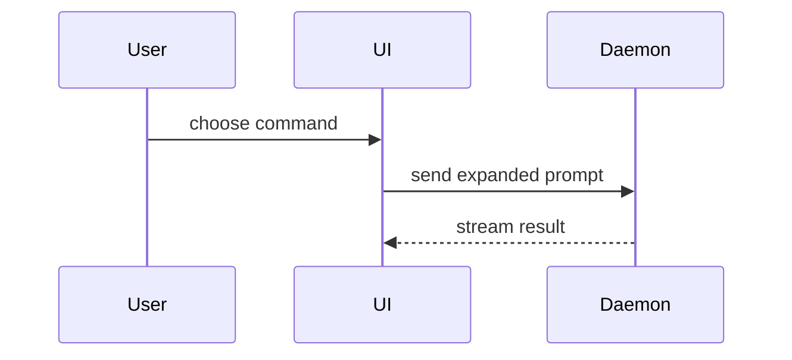

# PR 正文示例集

`pr` skill 的披露参考:Summary 各视图的可照抄形状。选型规则在 `SKILL.md`,这里只给形状。

## 伪代码——逻辑或算法

```text
on(save)
  if content is unchanged
    return cached result
  write new content
  return fresh result
```

## 调用树——运行时控制流

```text
submitForm
  createSession
    persistPrompt
    launchAgent
  navigateToSession
```

## 组件树——UI 结构(带文件路径)

```text
<SessionPage> (apps/example/src/routes/session.tsx)
  useSessionEvents()
  <SessionToolbar>
    <RunSkillButton> (packages/ui)
```

## 文件树——文件职责 / 大范围重构

```text
src/
├── commands/       # 解析用户动作
├── sessions/       # 持有 session 状态
└── transport/      # 发送 API 请求
```

## Mermaid——组件交互 / 控制流 / 数据流



## diff——组件改动

```diff
 <SessionPage>
   useSessionEvents()
   <SessionToolbar>
+    <RunSkillButton />
   <SessionTimeline>
+    <SkillResultCard />
```

## diff——文件布局改动

```diff
 src/
 ├── commands/
+│   └── show-me.ts       # 展开 slash command
 ├── sessions/
-└── transport.ts
+└── transport/
+    ├── client.ts
+    └── stream.ts
```

## diff——调用树改动

```diff
 submitForm
   createSession
     persistPrompt
+    expandSkillMention
     launchAgent
-  navigateToSession
+  navigateToSession
+    subscribeToEvents
```

## diff——状态 / 控制流改动

```diff
 on(save)
-  write content
+  if content is unchanged
+    return cached result
+  write new content
+  invalidate cache
```

## 整块代码——大部分是新代码

```ts
function expandSkill(command: string): string {
  const skillName = command.slice(1);
  return `use the ${skillName} skill`;
}
```

> Adapted from [mattpocock/skills](https://github.com/mattpocock/skills) — pr skill.
